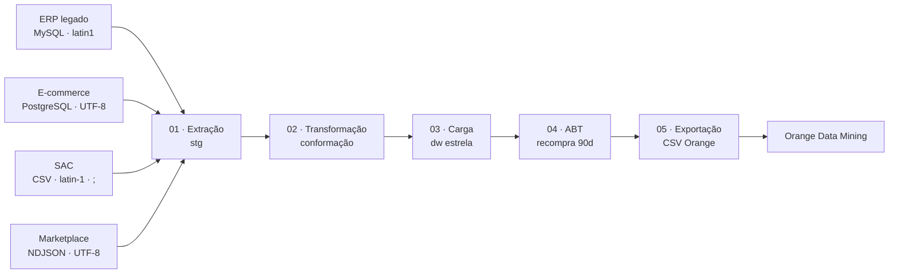
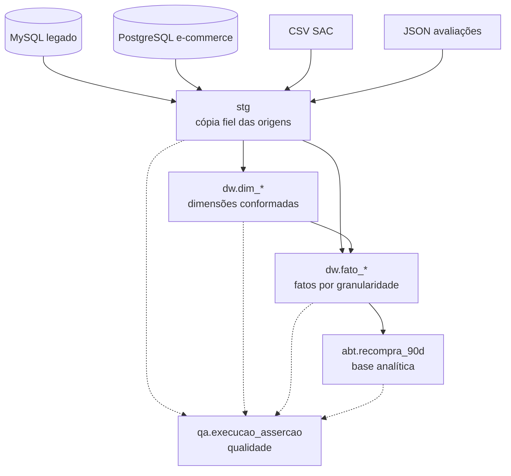
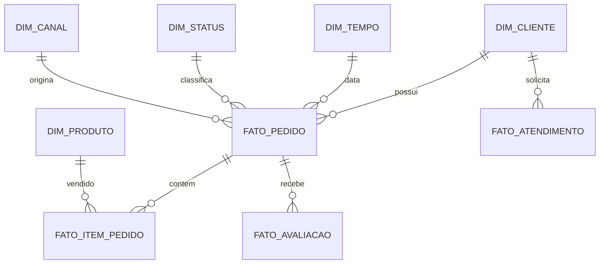
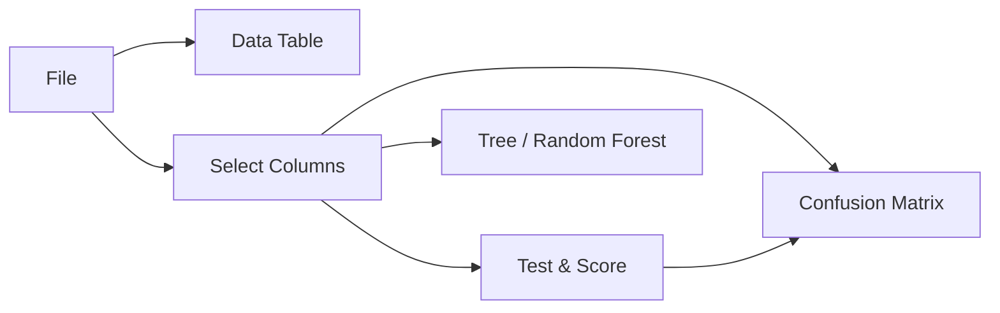

# Mineração de Dados — Laboratório ETL Mercatto Varejo

Projeto prático da disciplina de **Mineração de Dados — IFMT (2026/2)**. O laboratório simula a integração de dados de uma varejista que possui um ERP legado, uma plataforma de e-commerce, um sistema de atendimento e avaliações de marketplace.

O objetivo é construir um pipeline reprodutível de **extração, transformação, carga e preparação para mineração de dados**, respondendo à pergunta:

> Dado o comportamento de um cliente até **30/06/2025**, ele fará uma nova compra nos 90 dias seguintes?

O enunciado original está em [Projeto_Pratico_ETL_Mercatto.pdf](./lab-etl-varejo/lab-etl-varejo/pdf/Projeto_Pratico_ETL_Mercatto.pdf). O código executável fica em [lab-etl-varejo/](./lab-etl-varejo/).

## Visão geral

O projeto gera uma base determinística, disponibiliza as fontes em bancos distintos, extrai tudo para staging, conforma os dados em um esquema estrela e produz uma tabela-base analítica (ABT) para uso no Orange Data Mining.



### O que o pipeline entrega

- dados sintéticos com semente fixa, permitindo reproduzir os resultados;
- camada `stg` com cópia das fontes e metadados de procedência;
- clientes, produtos, status, canais e datas conformados;
- fatos de pedidos, itens, atendimentos e avaliações;
- asserções de qualidade registradas em `qa.execucao_assercao`;
- ABT correta, sem usar informação futura;
- ABT de comparação com vazamento intencional;
- CSVs prontos para exploração e modelagem no Orange.

## Arquitetura de dados

O Data Warehouse possui três camadas com responsabilidades diferentes:



### Modelo dimensional



Grãos principais:

| Tabela | Grão |
|---|---|
| `dw.dim_cliente` | um cliente conformado entre as origens |
| `dw.dim_produto` | um produto/catálogo de origem |
| `dw.fato_pedido` | um pedido, identificado por `LEG-n` ou `ECOM-n` |
| `dw.fato_item_pedido` | um item de um pedido |
| `dw.fato_atendimento` | um protocolo do SAC |
| `dw.fato_avaliacao` | uma avaliação do marketplace |

Manter pedidos e itens em fatos separados evita multiplicar frete e valor do pedido quando ele possui várias linhas. Atendimentos e avaliações também são preservados quando não existe uma associação confiável com um pedido.

## Fontes e volume de referência

Na escala padrão, o gerador usa a semente `20262` e produz aproximadamente 2,2 milhões de registros:

| Fonte | Principais entidades | Volume aproximado |
|---|---|---:|
| ERP legado | clientes, produtos, pedidos e itens | 574 mil |
| E-commerce | clientes, produtos, pedidos e itens | 1,37 milhão |
| SAC | atendimentos | 96 mil |
| Marketplace | avaliações | 160 mil |

As fontes contêm problemas realistas: duplicatas, CPFs ausentes ou inválidos, sentinelas de data, frete negativo, descontos especiais, itens órfãos, categorias livres, status semanticamente diferentes, campos opcionais e formatos de data/encoding distintos.

## Funcionalidades por etapa

### 0. Geração e carga inicial

O serviço `seed` cria os arquivos de entrada e inicializa os bancos. A carga é determinística e pode ser reduzida com `ESCALA=0.2`.

### 1. Extração — `01_extracao.py`

- lê MySQL, PostgreSQL, CSV e NDJSON;
- preserva os valores de origem na camada `stg`;
- adiciona `_fonte` e `_extraido_em`;
- trata os encodings e separadores próprios de cada fonte;
- executa verificações de cardinalidade, nulos e unicidade.

### 2. Transformação — `02_transformacao.py`

- normaliza CPF, nomes, cidades e estados;
- unifica clientes por CPF válido e, quando necessário, por `nome + cidade + UF`;
- conforma status, distinguindo `CANCELADO` por cliente e por pagamento;
- conforma canais: `FISICO`, `TELEVENDAS`, `ONLINE_PROPRIO` e `MARKETPLACE`;
- trata datas, ausências, categorias, valores e chaves de SAC/avaliações;
- registra decisões e exceções para o RDT.

### 3. Carga do DW — `03_carga_dw.py`

- recria a dimensão de tempo de `2022-12-01` a `2026-03-31`;
- carrega dimensões e fatos em ordem de dependência;
- usa carga completa e idempotente, com `TRUNCATE` antes da recarga;
- descarta itens órfãos da carga final, preservando a integridade referencial;
- usa cliente desconhecido para pedidos sem correspondência segura;
- grava asserções e reconciliações financeiras em `qa`.

### 4. ABT — `04_abt.py`

A ABT tem uma linha por cliente com pedido até a data de corte. O alvo é:

```text
alvo_recompra_90d = 1  se houver compra não cancelada entre 01/07/2025 e 28/09/2025
alvo_recompra_90d = 0  caso contrário
```

A versão correta calcula atributos somente até `2025-06-30`, como recência, frequência, valor monetário, ticket médio, prazo médio e taxa de cancelamento. A opção `--vazamento` demonstra como o uso de dados posteriores ao corte contamina uma avaliação de modelo.

### 5. Exportação — `05_exportar_orange.py`

Exporta `saida/abt_recompra_correta.csv` e `saida/abt_recompra_vazamento.csv`, com o cabeçalho esperado pelo Orange.

## Requisitos

- Docker Engine ou Docker Desktop;
- Docker Compose v2;
- 8 GB de RAM recomendados;
- cerca de 2 GB livres em disco na escala padrão;
- Orange Data Mining instalado localmente, caso queira executar a etapa de mineração.

Para máquinas com menos memória, altere `ESCALA=1.0` para `ESCALA=0.2` em [.env.example](./lab-etl-varejo/lab-etl-varejo/.env.example).

## Passo a passo de execução

Execute os comandos a partir de [lab-etl-varejo/lab-etl-varejo/](./lab-etl-varejo/lab-etl-varejo/).

### 1. Configurar e subir os serviços

```bash
cp .env.example .env
docker compose up -d --build
docker compose logs -f seed
```

Aguarde a mensagem `ambiente pronto.`.

### 2. Executar o pipeline

```bash
docker compose exec etl python 00_perfilamento.py
docker compose exec etl python 01_extracao.py
docker compose exec etl python 02_transformacao.py
docker compose exec etl python 03_carga_dw.py
docker compose exec etl python 04_abt.py --correta
docker compose exec etl python 04_abt.py --vazamento
docker compose exec etl python 05_exportar_orange.py
```

O perfilamento deve ser lido antes das transformações: ele documenta as cardinalidades e anomalias observadas nas quatro fontes.

### 3. Abrir os resultados no Orange

No Orange, use o widget **File** e abra um dos arquivos em `saida/`. Um fluxo recomendado é:



Use `alvo_recompra_90d` como variável-alvo. A ABT vazada é somente um experimento didático e não representa um cenário válido de produção.

## Serviços e acessos

| Serviço | Função | Acesso local |
|---|---|---|
| `mysql_legado` | ERP legado, `latin1` | `localhost:3307` |
| `pg_ecommerce` | origem e-commerce, UTF-8 | `localhost:5433` |
| `pg_dw` | PostgreSQL analítico | `localhost:5434` |
| `adminer` | inspeção via navegador | <http://localhost:8080> |
| `etl` | execução dos scripts Python | `docker compose exec etl bash` |

Credenciais de desenvolvimento: `etl_ro/etl_ro` nas origens e `postgres/postgres` no DW. As origens são somente leitura por desenho do laboratório.

## Qualidade e auditoria

As etapas registram verificações em `qa.execucao_assercao`:

```sql
SELECT etapa, nome, valor_obtido, valor_esperado, aprovado, executado_em
FROM qa.execucao_assercao
ORDER BY id DESC
LIMIT 50;
```

As verificações cobrem contagem de pedidos, reconciliação financeira, chaves estrangeiras, prazos de entrega, unicidade de entidades e cardinalidade da ABT.

## Estrutura do repositório

```text
lab-etl-varejo/lab-etl-varejo/
├── docker-compose.yml       # bancos, Adminer, seed e contêiner ETL
├── .env.example             # escala de geração
├── dados/                   # fontes geradas e arquivos de carga
├── etl/                     # etapas 00 a 05 e asserções
├── gerador/                 # geração determinística dos dados
├── sql/                     # DDL das origens e do DW
├── saida/                   # relatórios e CSVs para o Orange
├── docs/                    # dicionário, decisões e entregas
└── pdf/                     # enunciado do projeto
```

Documentos complementares:

- [README operacional](./lab-etl-varejo/lab-etl-varejo/README.md);
- [Dicionário de dados](./lab-etl-varejo/lab-etl-varejo/docs/DICIONARIO_DE_DADOS.md);
- [Modelo de Registro de Decisões](./lab-etl-varejo/lab-etl-varejo/docs/MODELO_RDT.md);
- [Documentação da Entrega 3](./lab-etl-varejo/lab-etl-varejo/docs/ENTREGA_3.md).

## Reiniciar do zero

Para reproduzir o ambiente limpo e validar a idempotência:

```bash
docker compose down -v
Remove-Item -Recurse -Force .\dados, .\saida   # PowerShell
# ou: rm -rf dados saida                         # Linux/macOS
docker compose up -d --build
docker compose logs -f seed
```

Depois, repita os comandos do pipeline. A semente fixa deve gerar os mesmos dados para a mesma escala.

## Problemas comuns

**Acentos aparecem como `ç` ou `ã`.** O legado deve ser lido com `latin1` e o e-commerce com UTF-8. Verifique as conexões em [etl/config.py](./lab-etl-varejo/lab-etl-varejo/etl/config.py).

**O serviço `seed` falha.** Consulte `docker compose logs seed` e, se necessário, execute `docker compose run --rm seed python carregar.py --forcar`.

**Falta memória durante a geração.** Use `ESCALA=0.2`, remova os volumes com `docker compose down -v` e suba novamente.

**O Orange não abre o arquivo.** Abra os CSVs em `saida/`; eles possuem o cabeçalho esperado pelo Orange. Os CSVs em `dados/` são fontes, não ABTs.

**`LOAD DATA LOCAL INFILE` é recusado.** O MySQL precisa estar iniciado com `--local-infile=1`, configuração presente no [docker-compose.yml](./lab-etl-varejo/lab-etl-varejo/docker-compose.yml).

## Licença

Consulte [LICENSE](./LICENSE).

